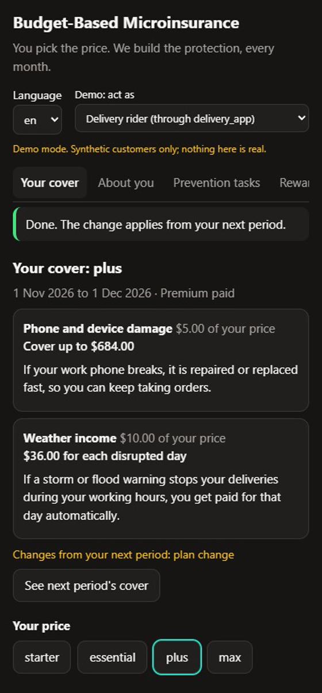
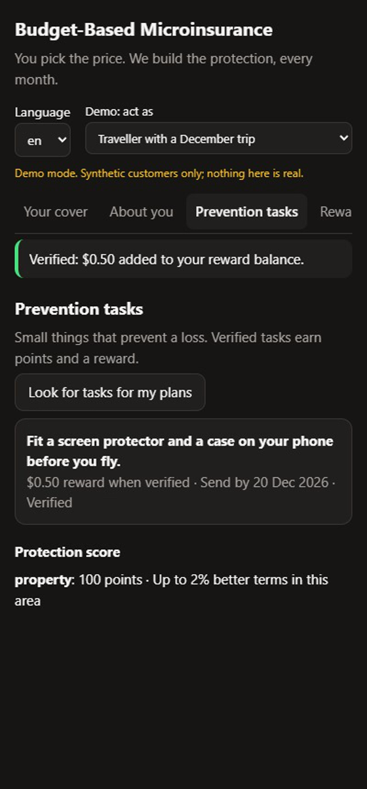
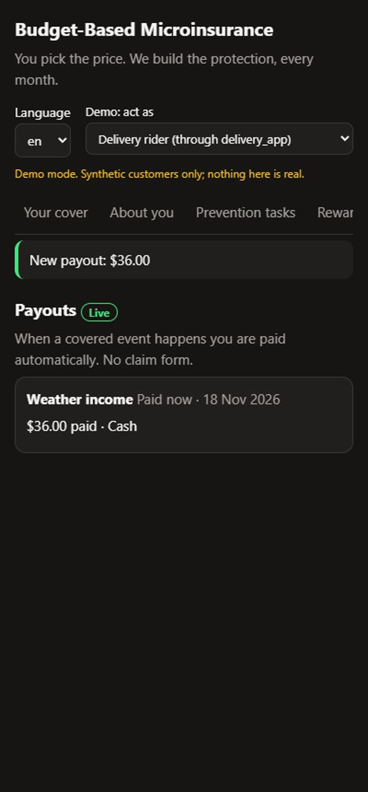
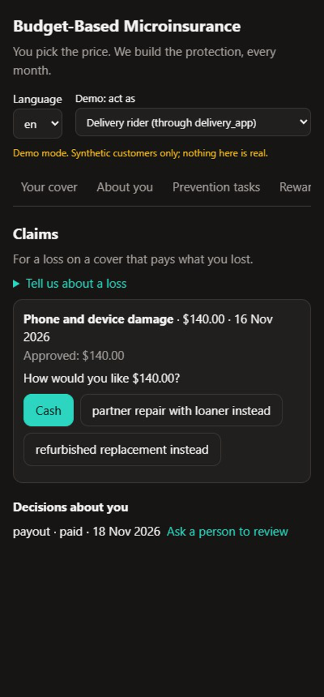
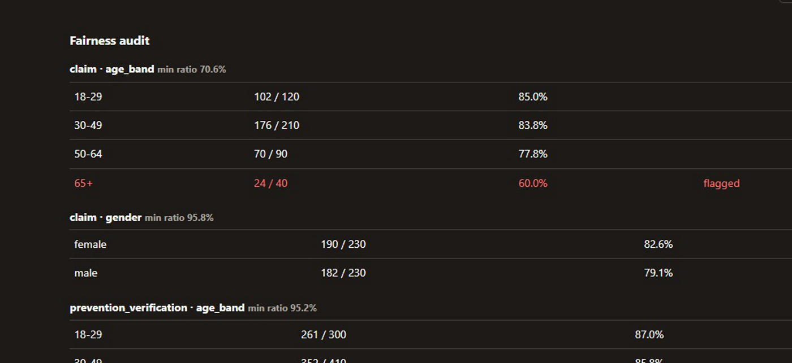

# Budget-Based Microinsurance

[](LICENSE)


**You pick the price. We build the protection, every month.**

Insurance sold like any other subscription: no agent, no forms, no 40-page wording. A customer
picks a monthly price (from $5). A deterministic engine turns that price into a personal set of
small covers, refitted every month to what is coming up in their life. Parametric covers pay
automatically the moment a storm warning or a concert cancellation is published. Between losses,
the customer gets prevention tasks and rewards, so the product is useful even in a month when
nothing goes wrong.

**Demo video (3 min):** `<add the YouTube link here>`

> [!NOTE]
> A design and engineering demonstration, not an insurance product or an offer of insurance.
> Every customer, claim and figure in `fixtures/` is synthetic.

## The problem

Small, personal insurance has never failed on demand. It fails on cost.

A delivery rider loses a whole day's pay when a storm shuts the city. Cover for that has existed
for decades, but a $5 policy cannot pay for the people around it: the agent who sells it, the
underwriter who rates it, the claims handler whose time costs more than the claim. So the people
with the least savings, such as gig workers, first-time buyers and anyone paid by the day, are
the ones insurance never reaches. A monthly product refitted to each customer would multiply that
per-customer work by twelve.

## The idea

| Traditional insurance | Budget-based microinsurance |
|---|---|
| Pick a cover, get a price | **Pick a price; the engine builds the cover** |
| Sold by an agent, once a year | Sold like a subscription, inside apps people already use (delivery, wallet, ticketing, telecom) |
| Meets the customer at purchase and at claim | Meets them every month |
| Pays after a claim form | Prevents, rewards, and pays automatically on a published trigger |

One loop per month:

```
Understand → Protect → Prevent → Verify → Reward → Recover → Learn → (next month)
```

## Why this is only possible with AI

The economics only work if the per-customer work costs almost nothing. That work is reading,
writing and judging unstructured things, which is what AI does now. The AI does the jobs a person
used to do, so a $5 plan can carry them:

| Loop stage | What the AI does | What it would otherwise take |
|---|---|---|
| Understand | Writes a short proposal form for the channel the customer came from, and turns their answers into profile facts they confirm | A long application form, or an agent |
| Understand | Reads what the customer chooses to share (a booking, a ticket) and lists the trips, events and new devices worth covering next month | A yearly review that never happens |
| Protect | Explains each cover, and each month's change, in one plain sentence | A policy wording nobody reads |
| Prevent | Writes one prevention task for a real event in this customer's life ("Fit a screen protector and a case on your phone before you fly") | A generic checklist |
| Verify | Checks the photo of a completed task, including whether it looks reused or edited (vision) | A person reviewing every photo |
| Reward | Orders the earned rewards by what this customer is likely to value | The same coupon for everyone |
| Recover | Reads a small claim's photos and documents and recommends approve or refer, so a claim within the insurer's authority is paid straight through | A claims handler for a loss smaller than the cost of handling it |

### How the AI is used, safely

**The AI recommends. A deterministic engine decides money.** Every price, sum insured and payout
is decided in [`crates/engine`](crates/engine): Rust with no I/O, no clock, no randomness and no
AI, using integer money (`Money(i64)`). The engine does not depend on the AI crate, so the
compiler enforces the boundary ([ADR-002](docs/decisions/ADR-002-decision-rights.md)).

- **Typed recommendations only.** [`crates/ai`](crates/ai) sends each component's prompt
  ([`crates/ai/prompts/*.md`](crates/ai/prompts), plain files loaded at runtime) and
  deserialises the reply into a typed recommendation. Fixed checks run on every reply: one
  sentence, no amounts, no protected attributes. Anything that fails to parse, times out or
  errors gets a saved answer from config instead (rule R22).
- **The AI can never decline a claim.** The straight-through outcome is
  `enum StpOutcome { Approved, Referred }`. There is no `Declined` variant, so only a named person
  can decline, and another person reviews it on request.
- **People stay in charge.** A random 1 in 20 of automated decisions goes to a person after
  payment, and a fairness audit compares approval rates across groups and flags any group below
  four-fifths of the best.
- **Protected attributes never reach a model.** Age, gender and area can be rating factors in the
  engine only where the insurer registers them; ethnicity, religion and nationality never.
- **Every prompt change is tested.** Golden sets in [`python/evals`](python/evals) run each
  component through the real harness (`just eval`), offline against saved replies or live with
  `EVAL_LIVE=1`.
- **The model never sees money.** The claims assessor is never sent the amount claimed, the sum
  insured or the premium.

Models: **Claude** via the Anthropic Messages API, a fast tier (`claude-haiku-5-5`) for short
customer-facing text and a strong tier (`claude-sonnet-5-5`) for judgement and images, set in the
insurer profile's `ai` section.

## See it

<table>
<tr>
<td width="25%"></td>
<td width="25%"></td>
<td width="25%"></td>
<td width="25%"></td>
</tr>
<tr>
<td valign="top"><b>Pick a price.</b> The optimiser splits it across covers in ~33 µs; the AI explains each in one sentence.</td>
<td valign="top"><b>Prevent.</b> The AI writes a task for this customer's trip and checks the photo.</td>
<td valign="top"><b>Paid automatically.</b> A storm warning (CAP 1.2) pays every matching policy. No claim form.</td>
<td valign="top"><b>Small claims.</b> The AI reads the photo and recommends; the engine pays within the insurer's authority.</td>
</tr>
</table>



**Insurer operations console:** the fairness audit, with a group flagged for a person to look at.

## Run it

Prerequisites: [Rust](https://rustup.rs) (the toolchain is pinned), [uv](https://docs.astral.sh/uv/),
Node 24 with [pnpm](https://pnpm.io), and [just](https://github.com/casey/just). Docker is
optional (PostgreSQL; demo mode keeps everything in memory).

```bash
git clone https://github.com/rairurairu/budget-based-microinsurance-all-you-can-do-with-ai
cd budget-based-microinsurance-all-you-can-do-with-ai
just setup   # toolchains and dependencies
just dev     # the whole stack, offline: synthetic customers, saved AI replies, no API key needed
```

Then open:

| URL | What |
|---|---|
| http://localhost:8080/app/ | Customer app (switch between synthetic customers at the top) |
| http://localhost:8080/embed/ | The partner embed (a Web Component a partner app drops in) |
| http://localhost:8080/partner/ | Partner console (aggregates only) |
| http://localhost:8080/ops/ | Insurer operations console |

Things to try in the customer app:

1. **Delivery rider → Your cover:** tap `max`. The covers re-split, each with a sentence from the AI.
2. **Traveller → Prevention tasks:** *Look for tasks*, *Take it on*, pick the sample photo, *Send evidence*.
3. **Delivery rider → Payouts**, then push a storm warning:
   ```bash
   curl -X POST http://localhost:8080/demo/replay/weather_alerts
   ```
   The payout appears live. (`organiser_notices` cancels the concert-goer's show.)
4. **Delivery rider → Claims:** report a cracked screen on 16 Nov 2026 for $140 with the
   description *"I dropped my phone on the pavement and the screen cracked across the middle."* and
   the sample photo `cracked_screen_synthetic.png`. It is approved straight through.

**With live AI:** set `ANTHROPIC_API_KEY` and run `just dev-live`. The synthetic customers stay,
but every AI component calls Claude; a failed call still falls back to its saved answer. Never
commit the key: `.env.example` shows the variables, and `.env` is git-ignored.

The demo runs in an international demonstration market (US dollars, English, storm warnings in
the [Common Alerting Protocol](https://en.wikipedia.org/wiki/Common_Alerting_Protocol)). A new
country is configuration, not code: `config/markets/<market>/` holds its currency, plans, data
feeds, language and limits. The repository ships two more market configurations as worked
examples (`just dev hk`, `just dev tw`).

| Command | Use |
|---|---|
| `just check` | Format, lint and type-check every language |
| `just test` | All tests |
| `just eval` | AI golden-set evaluations |
| `just bench` | Engine benchmarks |
| `just gen` | Regenerate contracts, the TypeScript client and the Python models |

## Measured

From [`docs/performance.md`](docs/performance.md), on a laptop:

| Path | Target | Measured |
|---|---|---|
| Trigger fan-out (one storm warning matching every active weather policy) | 1,000,000 policies in < 5 s on 4 vCPU | **1.6 s on one core** |
| Optimiser, per customer per month | < 50 µs | **32.8 µs** |
| Ledger, idempotent postings (PostgreSQL 16) | ≥ 5,000/s | **8,400/s** first post, 13,800/s retries |

About 330 tests across Rust, Python and TypeScript; 59 business rules, each with its source and a
test named after it ([`docs/rules.md`](docs/rules.md)); 12 architecture decision records
([`docs/decisions`](docs/decisions)), each mapped to existing insurance practice.

## Tools, APIs, models and libraries

| Layer | What we used |
|---|---|
| AI | **Claude** (Anthropic Messages API): `claude-haiku-5-5` and `claude-sonnet-5-5`, with vision for evidence photos; prompts as Markdown files; golden-set evals in Python |
| Engine | **Rust**: serde, chrono, thiserror; integer money; property tests with proptest; benchmarks with criterion |
| Services | Rust: **axum** and tokio (HTTP API, live payout stream), reqwest (model and data-feed calls), sqlx with **PostgreSQL** (ledger and policy store), quick-xml (CAP 1.2 alerts), schemars (JSON Schema) |
| Contracts | OpenAPI and JSON Schema generated from the Rust types; **openapi-typescript** for the client |
| Apps | **TypeScript**, framework-free: customer app, partner embed (Web Component), partner and operations consoles; Biome |
| Economics | **Python** with uv; the economic models call the production engine through **PyO3** bindings (maturin); pytest, ruff, pyright |
| Data feeds | Common Alerting Protocol 1.2 (weather warnings), an organiser notice feed; synthetic fixtures in demo mode |
| Infrastructure | Docker Compose (local), Terraform (AWS) |
| Built with | **Claude Code** as the AI coding agent (see below) |

## How it fits together

| Who | Decides | Never decides |
|---|---|---|
| **Deterministic engine** (`crates/engine`) | Plans, schedule, pricing, eligibility, triggers, payouts, rewards | Anything needing judgement of unstructured input |
| **AI** (`crates/ai`) | Understanding, explanation, reading the month ahead, prevention tasks, photo checks, claim recommendations, reward ranking | Prices, sums insured, payouts, claim declines |
| **People** (ops console) | Declines, reviews, the random 1-in-20 audit | Routine approvals |
| **The customer** | Price plan, accepting every change, cash or partner reward | — |

| Path | What it is |
|---|---|
| [`docs/`](docs) | Method, problem map, architecture, economic models, responsible AI, rules, regulation, pilot, glossary |
| [`config/`](config) | The adoption surface: insurer profile, plans, cover catalogue, data feeds, markets, language packs |
| `crates/engine` | Deterministic core: optimiser, consent, trigger matching, payouts, claims, prevention, rewards |
| `crates/ai` | The harnessed AI layer; prompts in `crates/ai/prompts/` |
| `crates/api`, `crates/workers` | HTTP API and scheduled jobs (trigger polling, renewals, claims, settlement) |
| `crates/triggers`, `crates/ledger`, `crates/store`, `crates/learning` | Data-feed adapters, double-entry ledger, policy store, privacy-enforced insights |
| `python/` | Economic models and the AI evaluations |
| `apps/` | Customer app, embed SDK, partner console, ops console |

[`ADOPTION.md`](ADOPTION.md) is the guide for an insurer or a distribution partner adopting it.

## How it was built

The product owner set the method, the decision-rights boundary between AI and engine, and the
product decisions, and reviewed each design against insurance practice. Claude Code, an AI coding
agent, wrote most of the code under the constraints in [`AGENTS.md`](AGENTS.md): the engine
boundary, integer money, test-first business rules and generated contracts. AI built it, and AI
runs inside it, with the money decisions kept where a compiler can check them.

## Team

**Fable 6.7**

- Tsang Cheuk Nam
- Choi Cheuk Man

## License

[Apache License 2.0](LICENSE). Copyright 2026 Tsang Cheuk Nam.
